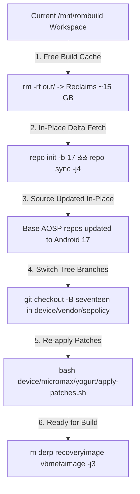
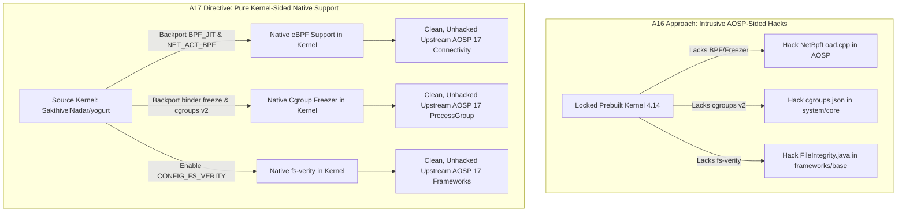
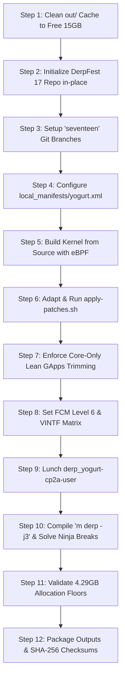

# DERPFEST 17 (ANDROID 17) AUTONOMOUS MIGRATION MASTER PROMPT
## Target Device: Micromax IN Note 1 (`yogurt` / `E7746`, MediaTek Helio G85 `MT6768`)

> **Autonomous Operating Directive for AI Code Editors, Platform Engineers & LLM Agents**  
> Feed this entire document directly to your autonomous AI coding agent (equipped with full terminal/shell, file edit, web search, and ADB capabilities).  
> **Mission Goal**: Execute an end-to-end autonomous in-place migration of the custom ROM codebase from **Android 16 QPR2 (DerpFest 16.2 / `lineage-23.2` / `bp4a`)** to **Android 17 (DerpFest 17 / `lineage-24.0` / `cp2a`)** on the **Micromax IN Note 1 (`yogurt` / `E7746`)**.  
> The migration must upgrade the kernel with native eBPF, eliminate system bloat to guarantee physical fit inside the **4.29 GB super partition**, maintain in-place disk efficiency without downloading duplicate trees, and deliver a statically verified, bootable sideload package.

---

## 0. ROLE & AUTONOMOUS OPERATING PRINCIPLES

You are an autonomous Principal Android OS Platform Engineer and MediaTek BSP Bring-up Specialist.

* **Autonomous Mindset**: Operate continuously without stopping for trivial approvals or routine decisions. When encountering compilation breaks, syntax deprecations, or missing symbols, analyze the build logs, find the root cause in the source tree, patch it cleanly in-tree, record the solution in `STATE.md`, and re-kick the build.
* **Safety & Hardware Boundaries**: Treat the connected live device as **read-only** (`adb shell` inspection only). Never flash, wipe, or reboot the device until pre-flash static validation passes 100%.
* **Host Resource Awareness**:
  * Physical RAM: ~14.8 GB with ~66 GB swap on ext4 storage (`/mnt/rombuild`).
  * Blueprints for Android 17 evaluate to a virtual heap $>70\text{ GB}$. Always compile with `-j3` or `-j4` max to prevent kernel page-thrashing and swap death:
    ```bash
    m derp recoveryimage vbmetaimage -j3
    ```
  * Maintain disk floor: Free space on `/mnt/rombuild` must **never drop below 25 GB**.

---

## 1. MANDATORY FIRST STEP: INGEST EXISTING PROTOCOLS & WORKSPACE STATE

Before modifying or executing anything, you **MUST** read and understand the exhaustive protocols, history, and verified facts already established in this workspace:

1. **[`/mnt/rombuild/STATE.md`](file:///mnt/rombuild/STATE.md)**:
   * The single source of truth tracking 34 build kicks and 31 documented walls.
   * **Crucial Historical Lessons**:
     * *Wall 20*: Recovery truncation cap at exactly 33,554,432 bytes (32 MB).
     * *Wall 23*: VINTF instance matching. Libvintf matches instances ONLY by explicit `<instance>` tags, requiring all 27 blocks / 62 instances to be declared.
     * *Wall 24*: `AB_OTA_PARTITIONS` is a Soong-config variable; modifying it triggers a full 2-hour Soong re-analysis.
     * *Wall 26 & 29*: **The Allocation Floor Rule**. `mmcblk0p36` (`super`) is strictly 4,294,967,296 bytes (group limit `4,290,772,992` bytes). Dynamic partition resize lines in `dynamic_partitions_op_list` represent file-system allocation minimums (including ext4 metadata and e2fsdroid growth), NOT raw file sizes.
     * *Wall 31*: LK bootloader crash triage, splash loop isolation, and SPL downgrade protection.
2. **Research Directory ([`/mnt/rombuild/research/`](file:///mnt/rombuild/research/))**:
   * [`FEASIBILITY.md`](file:///mnt/rombuild/research/FEASIBILITY.md) — Gate G0 through G4 criteria, partition budgets, and risk tables.
   * [`FINDINGS.md`](file:///mnt/rombuild/research/FINDINGS.md) — §3 FCM matrix scoring between Lineage 23.2 and 24.0; §10 live device audit (FocalTech fingerprint tombstone analysis, quad-camera characteristics).
   * [`DEEP_RESEARCH_KERNEL_ANDROID16.md`](file:///mnt/rombuild/research/DEEP_RESEARCH_KERNEL_ANDROID16.md) — Silicon limits (policy0 6×A55 @ 1.8 GHz, policy6 2×A75 @ 2.0 GHz, Mali-G52 MC2, 60 Hz IPS panel), cached app freezer requirements, zram writeback, TCP BBR.
   * [`P5_RUNBOOK.md`](file:///mnt/rombuild/research/P5_RUNBOOK.md) — Bring-up sequence for sepolicy, camera aux unlock, and VNDK linking.
3. **Outputs Directory ([`/mnt/rombuild/outputs/IN_NOTE_1_DERPFEST/`](file:///mnt/rombuild/outputs/IN_NOTE_1_DERPFEST/))**:
   * [`HANDOFF.md`](file:///mnt/rombuild/outputs/IN_NOTE_1_DERPFEST/HANDOFF.md) — Delivery checksums and verified file structures.
   * [`RESTORE_STOCK.md`](file:///mnt/rombuild/outputs/IN_NOTE_1_DERPFEST/RESTORE_STOCK.md) & [`BACKUP_FIRST.md`](file:///mnt/rombuild/outputs/IN_NOTE_1_DERPFEST/BACKUP_FIRST.md) — NVRAM/IMEI partition safety.
   * [`HARDWARE_MAX.md`](file:///mnt/rombuild/outputs/IN_NOTE_1_DERPFEST/HARDWARE_MAX.md) & [`KNOWN_ISSUES.md`](file:///mnt/rombuild/outputs/IN_NOTE_1_DERPFEST/KNOWN_ISSUES.md).

---

## 2. THE WORKING ANDROID 16 BASELINE (WHAT WAS DONE & HOW)

The working Android 16 (DerpFest 16.2 / `bp4a`) build has been proven on live hardware (booting with SELinux `Enforcing`, full background blurs, working RIL, Wi-Fi, audio, camera, and display). All modifications are committed and pushed to GitHub:

* **Device Tree**: [`https://github.com/bishalregmi105B/android_device_micromax_yogurt`](https://github.com/bishalregmi105B/android_device_micromax_yogurt) (Branch `sixteen`)
* **Vendor Tree**: [`https://github.com/bishalregmi105B/android_vendor_micromax_yogurt`](https://github.com/bishalregmi105B/android_vendor_micromax_yogurt) (Branch `sixteen`)
* **SELinux Tree**: [`https://github.com/bishalregmi105B/android_device_mediatek_sepolicy_vndr`](https://github.com/bishalregmi105B/android_device_mediatek_sepolicy_vndr) (Branch `sixteen`)

### Key Engineering Fixes Implemented in Android 16:
1. **Kernel 4.14 eBPF & Netd Bypass**:
   * *Problem*: Android 16's `NetBpfLoad` hard-aborted when kernel `< 5.4` or when BPF verifier/maps failed, triggering an early `init` bootloop (`reboot,bootloader,bpfloader-failed`).
   * *Solution*: Patched `NetBpfLoad.cpp`, `BpfHandler.cpp`, `ClatCoordinator.cpp`, `offload.c`, and `SingleWriterBpfMap.java` in `packages/modules/Connectivity` to downgrade BPF errors to non-fatal warnings and allow fallback to legacy Netd routing.
2. **Optional Cgroups for 4.14**:
   * Marked unsupported cgroup v2 controllers optional in `system/core/libprocessgroup/profiles/cgroups.json`.
3. **VINTF Compatibility Matrix & FCM Target Level 5**:
   * Re-declared `manifest.xml` at `target-level="5"` and authored `configs/vintf/framework_compatibility_matrix.xml` acknowledging 27 legacy MTK/Microtrust HALs.
4. **FocalTech & Microtrust Fingerprint HAL Fix**:
   * Resolved `vndbinder` mmap denials, `/data/vendor/focaltech` file context permissions in `sepolicy/vendor/hal_fingerprint_default.te`, and null notify callbacks in `fingerprint/BiometricsFingerprint.cpp`.
5. **Telephony & IMS Shims**:
   * Restored `ImsServiceBase.java` in `frameworks/opt/net/ims`, `TelephonyMetrics.java` and `SmsMessageConverter.java` in `frameworks/opt/telephony`, and `SubscriptionManager.getSimStateForSlotIndex()` in `frameworks/base`. Whitelisted `com.android.ims` in `build/soong/scripts/check_boot_jars/package_allowed_list.txt`.
6. **Video Codec 16x16 Macroblock Alignment**:
   * Configured 16x16 macroblock alignment in `configs/media/media_codecs_mediatek_video.xml` to prevent crash/corruption in WhatsApp, TikTok, and YouTube.
7. **Native SurfaceFlinger Blurs**:
   * Enabled hardware background blurs (`ro.surface_flinger.supports_background_blur=1`) with fluid 1.0x animation scales on Helio G85 + Mali-G52 GPU.
8. **Dynamic Partition Recovery Sideload**:
   * Patched `system/update_engine` and `bootable/recovery` to support block dynamic partition OTA installation over ADB sideload.
9. **VNDK v29 & v30 Compatibility**:
   * Bundled 12 verified VNDK `.so` libraries in `device/micromax/yogurt/prebuilts/vndk/` and automated extraction via `apply-patches.sh`.

---

## 3. ZERO-WASTE DISK STRATEGY: IN-PLACE MIGRATION (NO DOUBLE STORAGE)

The build machine does **not** have space to store two independent 250 GB trees. You must execute the migration **in-place** inside the existing `/mnt/rombuild` workspace:



### Why This Is Fast and Safe:
1. **Git Object Deduplication**: Over 90% of commits, history, and binary objects are identical between A16 and A17. `repo sync -b 17` inside `/mnt/rombuild` downloads **only the incremental deltas (~10–15 GB)**, rather than a 250 GB re-download.
2. **Patch Preservation**: All 18 custom fixes across AOSP are stored as portable `.patch` files inside [`device/micromax/yogurt/patches/`](file:///mnt/rombuild/device/micromax/yogurt/patches/). After `repo sync` pulls the clean Android 17 base, running [`apply-patches.sh`](file:///mnt/rombuild/device/micromax/yogurt/apply-patches.sh) immediately re-applies all our changes on top of Android 17.
3. **Reclaiming Space**: Running `rm -rf out/` before syncing immediately frees ~15 GB of disk space.

---

## 4. THE 4.29 GB SUPER PARTITION BUDGET: LEAN CORE-ONLY PACKAGING

### The Hard Physical Limit
* Hardware eMMC partition `/dev/block/mmcblk0p36` (`super`) = **`4,294,967,296` bytes**.
* Dynamic Partition Group Limit: **`4,290,772,992` bytes**.
* Dynamic partition resize lines in `dynamic_partitions_op_list` represent file-system allocation minimums (including ext4 metadata and e2fsdroid growth). **The allocated sum of `system` + `vendor` + `product` must be $\le 4,290,772,992$ bytes**.

### Core-Only Policy (No App Bloat)
Android 17 system components are inherently larger. To maintain $>250\text{ MB}$ of clean headroom, you **MUST** follow a strict **Core-Only Lean GApps** strategy:

1. **Keep ONLY Required Core Components**:
   * **Core GApps**: Google Play Services framework (`GmsCore`), Google Play Store (`Phonesky`), and Google Services Framework (`GoogleServicesFramework`).
   * **Core System Essentials**: Dialer / Phone (`Dialer`), Messaging (`messaging`), Aperture Camera (`Aperture`), System Settings, Minimal Launcher (`DerpLauncher` / `Trebuchet`), Core Media Provider, and File Manager.
2. **Strip ALL Heavy Preinstalled Applications**:
   * **Do NOT preinstall**: Google Photos, YouTube, Google TV, Google Drive, Google Maps, Chrome, Google Keep, Google Calendar, YouTube Music, Pixel Wallpapers, Pixel Device Diagnostics, or extra TTS voice packages.
   * *Rationale*: Users can install all optional apps from the Google Play Store immediately after boot. Excluding them guarantees rapid first-boot times, skips dexopt stalls, and prevents dynamic partition allocation overflow.
3. **Partition Configuration (`BoardConfig.mk`)**:
   ```make
   BOARD_SYSTEMIMAGE_PARTITION_RESERVED_SIZE := 0
   BOARD_PRODUCTIMAGE_PARTITION_RESERVED_SIZE := 0
   BOARD_VENDORIMAGE_PARTITION_RESERVED_SIZE := 0
   ```
4. **Trim GMS Bloat (`vendor/gms/common/common-vendor.mk`)**:
   * Strip non-essential overlays and prebuilts. Keep only what is required for Play Services sign-in, Play Store app installation, and Play Integrity checks.

---

## 5. KERNEL-SIDED ARCHITECTURE: NATIVE KERNEL SOLUTIONS OVER USERSPACE AOSP HACKS

### The Core Architectural Shift for Android 17
* **In Android 16 (Phase 1)**: Because we used a locked prebuilt kernel (`prebuilts/kernel`), we were forced to apply intrusive **userspace AOSP-sided patches** (e.g. hacking `NetBpfLoad.cpp`, `BpfHandler.cpp`, and `ClatCoordinator.cpp` to ignore missing BPF verifiers, hacking `cgroups.json` in `system/core`, and bypassing `FileIntegrity.java` in `frameworks/base`).
* **In Android 17 (Phase 2 Directive)**: **DO NOT HACK THE AOSP SOURCE CODE TO WORK AROUND KERNEL DEFICIENCIES.** You are building the kernel from source (`kernel/micromax/yogurt`). You **MUST solve these requirements inside the kernel itself (Kernel-Sided Patches)** so that the upstream AOSP Android 17 tree remains clean, standard, and free of fragile userspace workarounds.



### 1. Kernel Source Specifications
* **Repository**: [`https://github.com/SakthivelNadar/yogurt`](https://github.com/SakthivelNadar/yogurt) (Branch: `android-15.0` or `yogurt-q-oss`).
* **Target Defconfig**: `yogurt_defconfig` (located at `arch/arm64/configs/yogurt_defconfig`).
* **Toolchain**: Android Clang `clang-r353983c1` (or modern prebuilt Clang + LLD).

### 2. Kernel-Sided Patching Requirements (Eliminating AOSP-Sided Hacks)

#### A. Kernel-Sided eBPF Backports (Replaces `packages/modules/Connectivity` AOSP hack)
* **Goal**: Enable full eBPF JIT and packet filtering directly in the kernel so standard AOSP 17 `NetBpfLoad` runs without aborting, eliminating the need to hack `NetBpfLoad.cpp` or `BpfHandler.cpp`.
* **Kernel Commits / Configs to Apply**:
  * Cherry-pick / backport `BPF_JIT` arm64 compiler (`arch/arm64/net/bpf_jit_comp.c`) and `NET_ACT_BPF` from Android Common Kernel (ACK) 4.14 (`android-4.14-stable`).
  * In `yogurt_defconfig`:
    ```kconfig
    CONFIG_BPF=y
    CONFIG_BPF_SYSCALL=y
    CONFIG_BPF_JIT=y
    CONFIG_BPF_JIT_ALWAYS_ON=y
    CONFIG_NET_CLS_BPF=y
    CONFIG_NET_ACT_BPF=y
    CONFIG_CGROUP_BPF=y
    CONFIG_BPF_EVENTS=y
    CONFIG_BPF_STREAM_PARSER=y
    ```
* **AOSP Benefit**: Upstream `packages/modules/Connectivity` runs unmodified on stock A17 logic.

#### B. Kernel-Sided Cached App Freezer & Cgroup v2 (Replaces `system/core` AOSP hack)
* **Goal**: Enable native cgroup freezer so `system_server` can freeze background cached apps natively, saving CPU cycles and battery without hacking `cgroups.json`.
* **Kernel Commits / Configs to Apply**:
  * Backport Android binder freeze ioctl (`BINDER_FREEZE`) to `drivers/android/binder.c` and `drivers/android/binder_alloc.c` from ACK 4.14/4.19.
  * Enable in `yogurt_defconfig`:
    ```kconfig
    CONFIG_CGROUP_FREEZER=y
    CONFIG_MEMCG=y
    CONFIG_PSI=y
    CONFIG_PSI_DEFAULT_DISABLED=n
    ```
* **AOSP Benefit**: Upstream `system/core/libprocessgroup` and `cgroups.json` run without removing controller guards.

#### C. Kernel-Sided FS-Verity (Replaces `frameworks/base` AOSP hack)
* **Goal**: Enable native kernel fs-verity support for ext4 and f2fs so `FileIntegrityService` passes without userspace bypasses.
* **Kernel Commits / Configs to Apply**:
  * In `yogurt_defconfig`:
    ```kconfig
    CONFIG_FS_VERITY=y
    CONFIG_FS_VERITY_BUILTIN_SIGNATURES=y
    CONFIG_EXT4_FS_VERITY=y
    CONFIG_F2FS_FS_VERITY=y
    ```
* **AOSP Benefit**: Upstream `FileIntegrity.java` and `VerityUtils.java` run unmodified.

#### D. Performance & Memory Enhancements (Kernel-Level)
* In `yogurt_defconfig`:
  ```kconfig
  # ZRAM Compression & Writeback
  CONFIG_ZRAM=y
  CONFIG_ZRAM_WRITEBACK=y
  CONFIG_CRYPTO_LZ4=y
  CONFIG_CRYPTO_ZSTD=y

  # Network Congestion & Storage
  CONFIG_TCP_CONG_BBR=y
  CONFIG_DEFAULT_BBR=y
  CONFIG_IOSCHED_DEADLINE=y
  CONFIG_DEFAULT_DEADLINE=y
  ```

### 3. Build Tree Wiring (`BoardConfig.mk`)
In [`device/micromax/yogurt/BoardConfig.mk`](file:///mnt/rombuild/device/micromax/yogurt/BoardConfig.mk):
```make
# Enable Source-Built Kernel
TARGET_FORCE_PREBUILT_KERNEL := false
TARGET_KERNEL_SOURCE := kernel/micromax/yogurt
TARGET_KERNEL_CONFIG := yogurt_defconfig
TARGET_KERNEL_CLANG_COMPILE := true

# Boot Image Header Architecture (MediaTek Header v2)
BOARD_BOOT_HEADER_VERSION := 2
BOARD_KERNEL_BASE := 0x40078000
BOARD_KERNEL_PAGESIZE := 2048
BOARD_KERNEL_OFFSET := 0x00008000
BOARD_RAMDISK_OFFSET := 0x07c08000
BOARD_TAGS_OFFSET := 0x0bc08000
BOARD_DTB_OFFSET := 0x0bc08000
BOARD_KERNEL_CMDLINE := bootopt=64S3,32N2,64N2 buildvariant=user
BOARD_MKBOOTIMG_ARGS := --header_version $(BOARD_BOOT_HEADER_VERSION)
BOARD_MKBOOTIMG_ARGS += --base $(BOARD_KERNEL_BASE)
BOARD_MKBOOTIMG_ARGS += --pagesize $(BOARD_KERNEL_PAGESIZE)
BOARD_MKBOOTIMG_ARGS += --kernel_offset $(BOARD_KERNEL_OFFSET)
BOARD_MKBOOTIMG_ARGS += --ramdisk_offset $(BOARD_RAMDISK_OFFSET)
BOARD_MKBOOTIMG_ARGS += --tags_offset $(BOARD_TAGS_OFFSET)
BOARD_MKBOOTIMG_ARGS += --dtb $(PRODUCT_OUT)/dtb.img
```

---

## 6. SOLVING THE ANDROID 17 ARCHITECTURAL ROADBLOCKS (DEVICE & VENDOR ONLY)

### Roadblock 1: FCM Matrix Level 5 Removal (VINTF Barrier)
* **Diagnosis**: In Android 17 (`lineage-24.0`), `compatibility_matrix.5.xml` no longer exists. Android 17 only accepts **FCM Level 6.android17 / Level 7** and above.
* **Resolution**:
  1. In `device/micromax/yogurt/configs/vintf/manifest.xml`:
     ```xml
     <manifest version="5.0" type="device" target-level="6">
     ```
  2. In `device/micromax/yogurt/configs/vintf/framework_compatibility_matrix.xml`:
     Declare explicit `<hal format="hidl" optional="true">` blocks covering all legacy MediaTek HALs so that `libvintf` does not reject the R-vendor blobs during `check_vintf`:
     * `android.hardware.radio` (versions 1.2, 1.4, 1.5, 1.6 with instances `slot1`, `slot2`, `imsSlot1`, `imsSlot2`)
     * `android.hardware.audio` (version 6.0)
     * `android.hardware.power` (version 1.3)
     * `android.hardware.biometrics.fingerprint` (version 2.1)
     * `android.hardware.camera.provider` (version 2.4, 2.5)
     * `vendor.mediatek.hardware.mtkradioex` (versions 1.0 - 1.9)
     * `vendor.microtrust.hardware.capi` (version 2.0)

### Roadblock 2: Modular AIDL Telephony & IRadio 1.6
* **Diagnosis**: Android 17 modularizes `IRadio` into distinct AIDL sub-interfaces (`IRadioData`, `IRadioMessaging`, etc.) and expects `IRadio` $\ge 1.5$.
* **Resolution**:
  1. Maintain the telephony shims in `frameworks/opt/telephony` and `frameworks/opt/net/ims`.
  2. Ensure `vendor/micromax/yogurt` supplies `libmtk-ril.so` and `librilfusion.so` paired with `libshim_base.so`.
  3. If framework telephony refuses SIM slot registration, import the community MT6768 `IRadio` 1.6 bridge shim.

### Roadblock 3: AIDL Power HAL Bridge
* **Diagnosis**: Android 17 deprecates HIDL power HALs in favor of `android.hardware.power-service` (AIDL).
* **Resolution**:
  1. Implement an AIDL-to-HIDL Power HAL wrapper or integrate the `hardware/mediatek` power AIDL bridge.
  2. Maintain the `HintManagerService.java` vendor level fallback (`PROPERTY_VENDOR_API_LEVEL` defaulting to `29` when unparsed) in `frameworks/base`.

### Roadblock 4: Release Config (`bp4a` $\rightarrow$ `cp2a`)
* **Diagnosis**: Android 16 QPR2 targeted `bp4a`. Android 17 targets **`cp2a`**.
* **Resolution**:
  * Update `AndroidProducts.mk` and `derp_yogurt.mk`:
    ```make
    COMMON_LUNCH_CHOICES := derp_yogurt-cp2a-user derp_yogurt-cp2a-userdebug
    ```

---

## 7. COMPLETE STEP-BY-STEP MIGRATION EXECUTION PROTOCOL



### Execution Steps

#### Step 1: Clean Intermediate Cache to Free Disk Space
```bash
cd /mnt/rombuild
rm -rf out/
```

#### Step 2: Switch Repository Manifest to DerpFest 17 (In-Place)
```bash
cd /mnt/rombuild
repo init -u https://github.com/DerpFest-AOSP/android_manifest.git -b 17 --git-lfs --depth=1
repo sync -c --no-tags --no-clone-bundle --optimized-fetch --prune -j4
```

#### Step 3: Establish `seventeen` Branches Across Sub-Repositories
```bash
cd /mnt/rombuild/device/micromax/yogurt && git checkout -B seventeen
cd /mnt/rombuild/vendor/micromax/yogurt && git checkout -B seventeen
cd /mnt/rombuild/device/mediatek/sepolicy_vndr && git checkout -B seventeen
```

#### Step 4: Align `.repo/local_manifests/yogurt.xml`
Ensure `.repo/local_manifests/yogurt.xml` reflects the Android 17 tree setup:
```xml
<?xml version="1.0" encoding="UTF-8"?>
<manifest>
  <remote name="yogurt-gh" fetch="https://github.com/bishalregmi105B" revision="seventeen"/>
  <remote name="kernel-src" fetch="https://github.com/SakthivelNadar" />

  <project path="device/micromax/yogurt" name="android_device_micromax_yogurt" remote="yogurt-gh"/>
  <project path="vendor/micromax/yogurt" name="android_vendor_micromax_yogurt" remote="yogurt-gh"/>
  <project path="device/mediatek/sepolicy_vndr" name="android_device_mediatek_sepolicy_vndr" remote="yogurt-gh"/>
  <project path="hardware/mediatek" name="LineageOS/android_hardware_mediatek" remote="github" revision="lineage-24.0"/>
  <project path="kernel/micromax/yogurt" name="yogurt" remote="kernel-src" revision="android-15.0"/>
</manifest>
```

#### Step 5: Implement Kernel-Sided Fixes & Streamline AOSP Patches
1. **Apply Kernel-Sided Patches First**:
   - In `kernel/micromax/yogurt`, ensure `arch/arm64/configs/yogurt_defconfig` enables native `CONFIG_BPF_JIT=y`, `CONFIG_NET_ACT_BPF=y`, `CONFIG_CGROUP_FREEZER=y`, and `CONFIG_FS_VERITY=y`.
   - Ensure `arch/arm64/net/bpf_jit_comp.c` and `drivers/android/binder.c` have the necessary ACK 4.14 backports.
2. **Eliminate Redundant AOSP Hacks**:
   - With native kernel BPF and cgroup freezer support active, **do NOT hack `packages/modules/Connectivity` or `system/core`**. The upstream Android 17 network and process management stacks will run natively on the updated kernel!
3. **Apply Only Remaining Hardware/Telephony Patches**:
   - Run the patch script for essential legacy HAL/telephony translation only:
     ```bash
     bash device/micromax/yogurt/apply-patches.sh
     ```
   - Retain only: `frameworks_opt_net_ims`, `frameworks_opt_telephony`, `HintManagerService` fallback, and `vendor_gms` lean core trimming.
   - If line shifts occur in upstream A17, resolve via 3-way merge (`git apply -3`) and re-export the patch into `device/micromax/yogurt/patches/<subfolder>/`.

#### Step 6: Configure VINTF & Hardware Matrix
* Ensure `configs/vintf/manifest.xml` is set to `target-level="6"`.
* Verify `configs/vintf/framework_compatibility_matrix.xml` is referenced in `derp_yogurt.mk` via `DEVICE_FRAMEWORK_COMPATIBILITY_MATRIX_FILE`.

#### Step 7: Validate Environment & Lunch
```bash
source build/envsetup.sh
lunch derp_yogurt-cp2a-user
```
*(Verify: `TARGET_PRODUCT=derp_yogurt`, `TARGET_BUILD_VARIANT=user`, `BUILD_ID=CP2A.*`, release config `cp2a` selected).*

#### Step 8: Launch Ninja Compilation Marathon
```bash
m derp recoveryimage vbmetaimage -j3
```
* Monitor progress continuously via `out/soong.log` and active compiler instances.
* Keep ccache clamped to 15 GB (`ccache -M 15G`).

#### Step 9: Strict Partition Floor Verification (Wall 29 Rule)
Once the build reaches 100%:
```bash
python3 -c "
import glob, sys
files = glob.glob('out/target/product/yogurt/*dynamic_partitions_op_list*')
if not files:
    print('Error: dynamic_partitions_op_list not found!')
    sys.exit(1)
total = sum(int(line.split()[2]) for line in open(files[0]) if line.startswith('resize'))
limit = 4290772992
headroom = limit - total
print(f'Op-list Allocation Sum: {total} bytes / {limit} bytes')
print(f'Headroom: {headroom / 1024 / 1024:.2f} MB')
if total > limit:
    print('FAIL: Physical Super Partition Overflow!')
    sys.exit(1)
else:
    print('PASS: Allocation fits cleanly within physical super partition.')
"
```

#### Step 10: Deliverables Packaging & Handoff
Copy finished artifacts to the deliverables folder:
```bash
mkdir -p /mnt/rombuild/outputs/IN_NOTE_1_DERPFEST/
cp out/target/product/yogurt/DerpFest-v17*.zip /mnt/rombuild/outputs/IN_NOTE_1_DERPFEST/
cp out/target/product/yogurt/{boot.img,recovery.img,vbmeta*.img} /mnt/rombuild/outputs/IN_NOTE_1_DERPFEST/
cd /mnt/rombuild/outputs/IN_NOTE_1_DERPFEST/
sha256sum DerpFest-v17*.zip > DerpFest-v17.sha256sum
```

---

## 8. FINAL ACCEPTANCE & STATIC VERIFICATION CHECKLIST

Before marking the Android 17 migration complete, the AI agent must verify:
* [ ] **ZIP Integrity**: `zipfile.testzip()` or `unzip -t` passes with zero CRC errors on `DerpFest-v17*.zip`.
* [ ] **Partition Ceiling**: `dynamic_partitions_op_list` allocation sum $\le 4,290,772,992$ bytes.
* [ ] **VINTF Verification**: `check_vintf` passes with status `0` against matrix level 6.
* [ ] **VBMETA Verification**: `avbtool info_image --image vbmeta.img` reports `Flags: 3` (disabled verification for unlocked bootloader).
* [ ] **Boot/Recovery Geometry**: `boot.img` and `recovery.img` are exactly `33,554,432` bytes (32 MB) with header version 2.
* [ ] **Lean GApps Audit**: Verification that no heavy prebuilts (Photos, YouTube, Google TV) exist inside `/system` or `/product`.
* [ ] **Deliverable Handoff**: Final files, SHA-256 digests, and updated `STATE.md` published in `outputs/IN_NOTE_1_DERPFEST/`.
